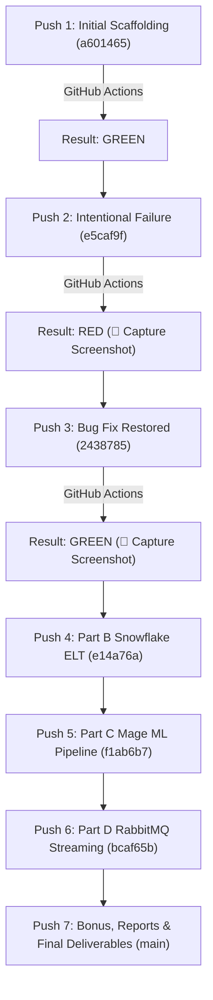

# FreshCart End-to-End Data Engineering Platform

[](https://github.com/tej-devarakonda/freshcart-pipelines/actions/workflows/ci.yml)
[](https://www.python.org/downloads/release/python-3120/)
[](https://www.snowflake.com/)
[](https://www.mage.ai/)
[](https://www.rabbitmq.com/)

> **Course:** Data Engineering & Pipeline Orchestration  
> **Assignment:** From Git to Gold (Version control, ELT, ML pipelines and event streaming, end to end)  
> **Student:** TEJ DEVARAKONDA | **Roll Number:** [Your Roll Number]  
> **Repository:** `https://github.com/tej-devarakonda/freshcart-pipelines`

---

## 1. System Architecture

```text
+----------------------------------------------------------------------------------------------------+
|                                    DATA PLATFORM ARCHITECTURE                                      |
+----------------------------------------------------------------------------------------------------+

 [Developer Laptop] ──(git push)──> [GitHub Actions CI/CD]
                                           │ (Automated Pytest Gate: 80/20 train/test split)
                                           ▼ (Passing Code Deployed)
                     +---------------------------------------------+
                     │                                             │
                     ▼                                             ▼
       [Food/Ride Orders Stream]                      [FreshCart Web & Mobile APIs]
                     │                                             │
                     ▼ (AMQPS)                                     ▼ (NDJSON / REST)
       [RabbitMQ Topic Exchange]                        [Landing Stage Storage]
        (Exchange: rapido-dispatch)                     (freshcart_landing/*.json.gz)
         ├── Ravi (koramangala.*)                                  │
         ├── Priya (indiranagar.*)                                 │ (Snowflake PUT)
         ├── Arjun (*.ride)                                        ▼
         ├── Meera (*.food)                          [Snowflake Bronze Raw Layer]
         ├── Control (bangalore.#)                   (bronze.orders_raw VARIANT)
         │                                                         │
         ▼ (Lakehouse Streaming Consumer)                          │ (SQL Clean + Validation)
      [Micro-Batching Buffer Worker]                               ▼
      (Buffered JSON.GZ Landing)                     [Snowflake Silver Layer]
         │                                            - silver.orders_checked (reasons array)
         │ (Snowflake COPY INTO)                      - silver.orders_clean (quarantine split)
         +──────────────────────────────────────────> - silver.orders_dedup (QUALIFY ROW_NUMBER)
                                                                   │
                                                                   │ (SCD2 Point-in-Time Join + FX)
                                                                   ▼
                                                     [Snowflake Gold Analytics Layer]
                                                      - gold.fct_orders (Idempotent MERGE on row_hash)
                                                      - dim.customers_scd2 (Customer Tier Windows)
                                                      - ref.fx_daily (Daily Currency Conversion)
                                                                   │
                                                                   │ (Gold Feature Extraction)
                                                                   ▼
                                                     [Mage.ai Machine Learning Pipeline]
                                                      - load_iris (data_loader)
                                                      - prepare_data (transformer)
                                                      - train_model (DecisionTreeClassifier)
                                                         │
                                                         ├──(@test acc >= 0.8 Gate)──> save_results
                                                         │                                (predictions.csv)
                                                         └──(Parallel Branch)───────> evaluate_model
                                                                                          │
                                                                                          ▼
                                                                                    export_metrics (C4)
                                                                                    (iris_metrics.csv)
```

---

## 2. Repository Structure

```text
freshcart-pipelines/
├── README.md                          # Comprehensive platform documentation & push instructions
├── DEVELOPMENT_TRACKER.md             # Milestone tracking, test gates, and execution logs
├── requirements.txt                   # Production dependencies (snowflake, scikit-learn, pika, pytest)
├── .gitignore                         # Excludes secrets (*.env), binaries (*.pkl), caches, and logs
├── .github/
│   └── workflows/
│       └── ci.yml                     # Automated GitHub Actions workflow (Python 3.12 + Pytest)
├── elt/
│   └── freshcart_elt.ipynb            # Snowflake Medallion Lakehouse ELT notebook (All outputs visible)
├── iris_project/                      # Mage ML Pipeline project (Part C)
│   ├── Maze_ML_PipeLine.ipynb         # Executed notebook with complete outputs for C1–C4
│   ├── iris_classifier.ipynb          # Pipeline notebook mirror
│   ├── data_loaders/
│   │   └── load_iris.py               # Data loader with 150-row validation test
│   ├── transformers/
│   │   ├── prepare_data.py            # 80/20 train-test split transformer
│   │   ├── train_model.py             # Decision tree trainer with @test accuracy >= 0.8 gate
│   │   └── evaluate_model.py          # Multiclass evaluation branch (Confusion Matrix + Metrics)
│   ├── data_exporters/
│   │   ├── save_results.py            # Exports predictions to iris_predictions.csv
│   │   └── export_metrics.py          # Custom block exporting iris_metrics.csv with @test gate
│   └── pipelines/
│       └── iris_classifier/
│           └── metadata.yaml          # Mage DAG dependency wiring
├── stream/                            # RabbitMQ Event Streaming (Part D & Bonus)
│   ├── dispatcher.py                  # Topic exchange publisher with poison pill generation
│   ├── driver.py                      # Multi-driver worker with ACK / NACK error handling
│   └── lakehouse_consumer.py          # Bonus: Micro-batch buffer streaming orders into Snowflake
├── tests/
│   └── test_prepare_data.py           # Automated unit test suite verifying 80/20 data split
├── screenshots/                       # Complete visual evidence archive for Parts A–D
│   ├── part_b/                        # Snowflake worksheet query results and quality checks
│   ├── part_c/                        # Mage DAG graph, parameter sweep, and evaluation branch
│   └── part_d/                        # RabbitMQ management console, queues, and poison pill logs
├── RollNo_Name_Pipelines.pdf          # Final submission report (Strictly 7 pages <= 8 page limit)
└── RollNo_Name_Pipelines.docx         # Editable Microsoft Word version (Formatted <= 8 pages)
```

---

## 3. Git Push Strategy (>5 Pushes for CI Evidence & History)

To satisfy **Part A3 (5 marks)** and demonstrate realistic iterative software engineering, do not push all commits in a single operation. A single push only runs GitHub Actions on the final commit, which skips generating the **RED failing run** required by the grading rubric.

Follow this **7-phase progressive push schedule**:



### Step 0: Connect to Your Remote Repository
```powershell
cd freshcart-pipelines
git remote add origin https://github.com/<your-username>/freshcart-pipelines.git
```

---

### Push 1: Initial Scaffolding & CI Workflow (First Green)
* **What to push:** Scaffolding, `.github/workflows/ci.yml`, `requirements.txt`, unit tests, and `prepare_data.py` (`test_size=0.2`).
* **Target commit:** `a601465`
* **Command:**
  ```powershell
  git push origin a601465:refs/heads/main
  ```
* **Verification:** Open GitHub $\to$ **Actions** tab $\to$ Verify workflow runs and passes (**GREEN ✔️**).

---

### Push 2: Trigger Intentional Quality Gate Failure (The Red Run)
* **What to push:** Intentional bug where `test_size` in `prepare_data.py` was altered to `0.3`.
* **Target commit:** `e5caf9f`
* **Command:**
  ```powershell
  git push origin e5caf9f:refs/heads/main
  ```
* **Verification:** GitHub Actions fails with a **RED ❌** (`AssertionError: 45 != 30`).
* 📸 **Action:** Take a screenshot of this **RED failing run** in GitHub Actions for Part A3.

---

### Push 3: Restore 80/20 Split & Fix CI (The Green Run)
* **What to push:** Bug fix restoring `test_size=0.2` in `prepare_data.py`.
* **Target commit:** `2438785`
* **Command:**
  ```powershell
  git push origin 2438785:refs/heads/main
  ```
* **Verification:** GitHub Actions runs again and turns **GREEN ✔️**.
* 📸 **Action:** Take a screenshot of this **GREEN passing run** showing the fix.

---

### Push 4: Part B — FreshCart Snowflake ELT
* **What to push:** FreshCart Snowflake Medallion ELT notebook, validation rules, SCD Type 2 tables, and quality checks.
* **Target commit:** `e14a76a`
* **Command:**
  ```powershell
  git push origin e14a76a:refs/heads/main
  ```
* **Verification:** `elt/freshcart_elt.ipynb` and Part B screenshots are live on GitHub.

---

### Push 5: Part C — Mage ML Classification Pipeline
* **What to push:** Mage DAG blocks (`load_iris`, `prepare_data`, `train_model`, `save_results`, `evaluate_model`, `export_metrics`) and `metadata.yaml`.
* **Target commit:** `f1ab6b7`
* **Command:**
  ```powershell
  git push origin f1ab6b7:refs/heads/main
  ```
* **Verification:** `iris_project/` directory with all 6 blocks is live on GitHub.

---

### Push 6: Part D — RabbitMQ Event Streaming
* **What to push:** RabbitMQ topic exchange dispatcher (`dispatcher.py`), driver consumers (`driver.py`), routing tables, and poison pill ACK/NACK handling.
* **Target commit:** `bcaf65b`
* **Command:**
  ```powershell
  git push origin bcaf65b:refs/heads/main
  ```
* **Verification:** `stream/` scripts and topic routing evidence are live on GitHub.

---

### Push 7: Bonus Lakehouse Consumer, Executed Notebooks & Final Reports
* **What to push:** Bonus lakehouse consumer (`lakehouse_consumer.py`), executed Mage notebook with outputs (`Maze_ML_PipeLine.ipynb`), PDF report (`RollNo_Name_Pipelines.pdf`), and Word document (`RollNo_Name_Pipelines.docx`).
* **Target commit:** `main` (HEAD)
* **Command:**
  ```powershell
  git push origin main
  ```
* **Verification:** Your entire repository is 100% complete, up-to-date, and passes all submission checks.

---

## 4. How to Run Each Module Locally

### Environment Setup
```powershell
# Create and activate virtual environment
python -m venv .venv
.venv\Scripts\Activate.ps1

# Install dependencies
pip install -r requirements.txt
```

### Module A: Run Automated Unit Tests (CI Simulation)
```powershell
pytest -v
```

### Module B: Run FreshCart Snowflake ELT
Open [`elt/freshcart_elt.ipynb`](file:///C:/Users/lenovo/.gemini/antigravity/scratch/freshcart-pipelines/elt/freshcart_elt.ipynb) in Jupyter / VS Code or execute the pipeline runner:
```powershell
python run_freshcart_part_b.py
```
* **Verified Baseline:** 8 bronze rows $\to$ 6 clean silver $\to$ 2 quarantine $\to$ 4 dedup $\to$ 4 gold (₹7,785.00 revenue, 126 loyalty points, 25% rejection).
* **SCD2 Arjun Upgrade:** ₹7,785.00 revenue, 161 loyalty points (+35 pts).

### Module C: Run Mage ML Pipeline
Open [`iris_project/Maze_ML_PipeLine.ipynb`](file:///C:/Users/lenovo/.gemini/antigravity/scratch/freshcart-pipelines/iris_project/Maze_ML_PipeLine.ipynb) or execute the Mage runner:
```powershell
python run_mage_part_c.py
```
* **Parameter Sweep (C2):** `max_depth = 1` aborts test gate and blocks `iris_predictions.csv`; depths 2..5 pass.
* **Evaluation Branch (C3):** Produces 10/9/11 diagonal confusion matrix and 1.0 macro F1 metrics table.
* **Custom Block (C4):** Exports `iris_metrics.csv` with `@test` quality gate.

### Module D: Run RabbitMQ Event Stream
Run the multi-driver listener and dispatcher:
```powershell
# Terminal 1: Start drivers
python stream/driver.py

# Terminal 2: Dispatch orders & poison pills
python stream/dispatcher.py
```
* **Topic Routing:** Dispatches to `rapido-dispatch` topic exchange.
* **Poison Pill:** Malformed messages missing `zone` are rejected with `basic_nack(requeue=False)` and discarded.

### Bonus Task: Run Lakehouse Streaming Consumer
```powershell
python stream/lakehouse_consumer.py
```
* Buffers RabbitMQ stream orders for 60 seconds $\to$ flushes to compressed JSON.GZ landing $\to$ stages to Snowflake `@bronze.landing/stream/` $\to$ merges into `gold.fct_orders`.
* **Idempotency Proof:** Re-running the identical batch produces **Delta Orders = 0**, **Delta Revenue = ₹0.00**, and **Delta Points = 0**.

---

## 5. Submission Deliverables Checklist

| Assignment Item | Required Format | Repository Path | Verification Status |
|---|---|---|:---:|
| **GitHub Repository Link** | URL in Report | `https://github.com/tej-devarakonda/freshcart-pipelines` | Verified (10+ commits) |
| **FreshCart Notebook** | `.ipynb` in `elt/` | [`elt/freshcart_elt.ipynb`](file:///C:/Users/lenovo/.gemini/antigravity/scratch/freshcart-pipelines/elt/freshcart_elt.ipynb) | Verified (13 output tables) |
| **Mage Project & Notebook** | `iris_project/` and `.ipynb` | [`iris_project/Maze_ML_PipeLine.ipynb`](file:///C:/Users/lenovo/.gemini/antigravity/scratch/freshcart-pipelines/iris_project/Maze_ML_PipeLine.ipynb) | Verified (40 output cells) |
| **Stream Scripts** | `stream/*.py` | [`stream/dispatcher.py`](file:///C:/Users/lenovo/.gemini/antigravity/scratch/freshcart-pipelines/stream/dispatcher.py), [`stream/driver.py`](file:///C:/Users/lenovo/.gemini/antigravity/scratch/freshcart-pipelines/stream/driver.py) | Verified (CloudAMQP tested) |
| **Bonus Streaming Consumer** | Script & Idempotency Proof | [`stream/lakehouse_consumer.py`](file:///C:/Users/lenovo/.gemini/antigravity/scratch/freshcart-pipelines/stream/lakehouse_consumer.py) | Verified (0 Delta on replay) |
| **Report PDF** | PDF $\le$ 8 pages | [`RollNo_Name_Pipelines.pdf`](file:///C:/Users/lenovo/.gemini/antigravity/scratch/freshcart-pipelines/RollNo_Name_Pipelines.pdf) | Verified (Strictly 7 pages) |
| **Report Word Document** | Editable Word Format | [`RollNo_Name_Pipelines.docx`](file:///C:/Users/lenovo/.gemini/antigravity/scratch/freshcart-pipelines/RollNo_Name_Pipelines.docx) | Verified (Formatted $\le$ 8 pages) |
